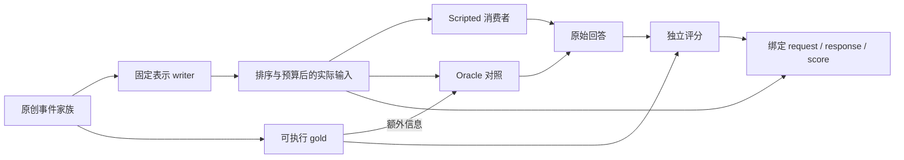

# Agent Memory Study

**经验如何成为可继承、也可改变的能力？**

AMS 从 agent memory 出发，研究信息、经验与智能的跨时间关系。我们关心经验怎样获得形式，过去怎样参与当下，以及系统怎样在改变中保持连续性。IR、表示、学习、数据系统及其基础问题，都可以在这里独立深入。

[进入研究书房](https://indeliblevivi.github.io/agent-memory-study/) · [工作 thesis](study/programme/thesis.md) · [怎样学习与生长](study/programme/method.md) · [研究体目录](study/README.md)

这里的 thesis 是可修订的研究立场。我们沿具体对象考察保留状态、取用条件和改变方式之间的关系，不预先假定所有 memory 都是同一种机制，也不要求每次学习交付一项工程建议。

## 从哪里开始

| 想进入的地方 | 可以读什么 |
| --- | --- |
| jieba、BM25、BGE-M3 究竟在做什么 | [找到一样的，还是找到相关的？](study/entries/retrieval-and-relevance.md)：从词项权重与混合排序的可行区间，走到原创集合中的近邻重合、精确率和召回率；网页可以改变候选数、排序和相关性定义。 |
| Database、Index、Retriever、Memory 怎样区分 | [一条记录、一种表示、一个记忆系统](study/entries/records-representations-systems.md)：从同一条工具版本记录看不同研究对象和功能角色。 |
| 新材料怎样改变已经形成的认识 | [索引也能学习——究竟学了什么？](study/entries/what-an-index-learns.md)：从指定章节追问监督与错误恢复；网页可插入记录，比较旧界、重新校准与重新拟合，并检查真实二分路径。 |
| 继续一项已有研究 | [经验怎样长成判断习惯](https://indeliblevivi.github.io/agent-memory-study/study/experience-becomes-policy/)：跨源论述、已保存的分类器学习与纠正结果，以及仍未回答的问题。 |
| 运行表示研究的离线控制 | [原事件／概括／并存执行器](research/representation-use-study/README.md)：原创事件、可执行真值、实际送达材料与绑定的运行证据；scripted/oracle 控制不等于模型效果。 |
| 检查更正怎样传到后续行动 | [修订传播与再写入实验](research/revision-propagation-study/README.md)：多层快照、延迟同步、单层干预与后续任务，区分持续错误和修好后的旧影响再现。 |
| 看项目长期关心什么 | [经验的形式](study/programme/directions/forms-of-experience.md)、[当下的相关性](study/programme/directions/relevance-in-context.md)、[改变与继承](study/programme/directions/change-and-continuity.md)。 |

这些新文章是基于公开来源与原创例子写成的研究内容，不是私人聊天的重建。当前有 12 篇学习／研究文章、27 份来源札记、2 个问题专题、5 条实践判断。领域与方向只是可改的阅读地图；数量、关联和阅读深度不代表个人掌握度。

## Relata × AMS 交叉研究

[交叉研究准备包](research/relata-ams-campaign/README.md)把未知未来用途、更正传播与原生操作的可观察边界接到现有实验。共享来源、family lineage 和实际交付证据；各自的 estimand、允许行动与研究结论保持独立。P1/P2 的独立出题流程和 operation map 是研究准备，不是新的自然语言模型结果。P3/P4/P6 保留各自设计，Relata 的人与互动研究独立进行；参数学习、cache 与跨模型 KV 研究也不以关系应用为前提。

该准备包、当前研究案头／作者接续与索引演算变化位于 PR #8 研究分支，未由此合入 main 或部署。Relata 的固定 capture reader 后续另有具名执行包；既有 scripted/oracle 矩阵不冒充真实语义能力。

## 研究怎样生长

从名字、例子、公式或疑惑开始，把真正学到的解释写下来。需要深入时，可以做推导、辨析定义、寻找反例、对读原文、观察实现或设计实验；增加论文数量只是其中一种手段。新材料可能补基础、解释机制、构成反例、开启旁支，也可能暂时放下。它的去向取决于内容，不能由相似度自动决定。

[研究方法](study/programme/method.md)说明怎样选一次研究的落点、接住新材料、修订已有理解，以及在哪里停下与继续。[作者指南](docs/authoring.md)提供实际的文件、命令和发布流程。一个简短学习记录无需先有成熟问题、实验或统一的章节模板。

## 仓库里的研究体

| 真源 | 负责什么 |
| --- | --- |
| `study/programme/` | 工作 thesis、研究方法与长期方向的完整论述 |
| `study/entries/*.md` + `*.json` | 正文与轻量 metadata；programme 的 metadata 也在这里 |
| `study/sources/` | 来源身份、实际阅读范围、札记、独立 evidence 与有署名的编辑判断 |
| `study/inquiries/` | 持续的问题、竞争解释与下一步 |
| `study/transfers/` | 可选的实践判断、适用条件与公开取用记录 |
| `study/map.json`、`catalog.json` | 研究导航、展示次序与旧 atlas 定义 |
| `research/` | 各项研究自己的协议、runner、输入、结果与限制 |

`tools/content.py` 把研究体编译为 `data/materials.json`；`tools/build.py` 生成 `assets/materials-data.js`。这两份文件是兼容原 reader／CLI 的 generated projections，不能手工编辑。原有 ID、材料深链接、27 份札记、4 篇共读与研究 receipts 均继续可查。旧 failure-surface 地图和阅读路径保留为可选入口；新版研究星图是主导航中的独立阅读视图；反向 membership 从 source 生成。

## 人与机怎样继续读

每篇来源、文章、问题与实践判断都有同源的 Markdown / JSON 研究包，包含正文或札记、署名、范围、版本日期和显式 ID 引用 manifest。包不抓取引用全文、不递归展开整个研究库，也不把研究文字当作 agent instructions。

```bash
node tools/export_study.cjs --kind study --id retrieval-and-relevance --format markdown
node tools/export_study.cjs --kind question --id experience-to-capability --format json
```

网页详情底部可导出研究包。在发布构建中，对象目录下也有 `index.md` 与 `index.json`，不需要 JavaScript。`contentVersion` 是编辑日期／edition，不是不可变 commit；需要固定引用时同时保留 Git revision 或包文件。

读到一半，可以在详情页写一段自己的接续笔记，主动下载 JSON，之后从首页“打开接续文件”恢复公开对象、章节位置和支持的演算状态。笔记只在页面内存与自己保存的文件里；刷新前未下载的修改会丢失。导入不执行文件中的文字，也不加载任意 URL。它不是在线批注、账号服务或云同步。

研究案头把多份文章、来源、问题和判断组织成一次工作：选材、对读、带来源版本的摘录／批注、自己的问题与解释、回正文核对和整组保存相连。详情中的双向显式引用可以继续阅读和选材；修订检查范围保留引用路径，不把引用当作论证依赖。案头可以逐字段查看保存时与当前的内容；确认当前正文不会改写旧摘录的来源。

私人案头 JSON 先预览再打开，编辑、选材、摘录和导入共享有限撤销／重做。案头最多 24 个对象、每对象 12 条摘录、文件最多 2 MiB，仅在页面内存与用户主动保存的文件中。新文件使用 `ams-workspace/2`，仍兼读旧版案头；单篇接续继续可用，两者共享笔记状态。刷新前请保存文件，历史与离开提示都不替代备份。

案头达到容量上限时，无法自动记下的新阅读位置会明确提示，原有工作保留；仍可离开正文、下载单篇接续或保存已接受的案头。

“公开选材包”只导出选定的当前公开对象，案头名称、问题、私人笔记、摘录记录／用途／批注和旧快照不会混入。机器也能沿同源出口取用：

```bash
node tools/export_study.cjs --select study:retrieval-and-relevance \
  --select study:what-an-index-learns --format markdown
node tools/export_study.cjs --workspace /path/to/ams-workspace.json --format json
```

索引演算的分布、插入状态、维护方式与查找键可以随单篇接续或案头 JSON 恢复，也保留在公开演算 URL 中。这里只能选择固定教学数据与有限整数键；个人笔记继续留在文件内。无 JavaScript 页面保留默认图解、结果与逐键表，移除操作控件。

私人案头也能经 `tools/author.py draft-from-workspace` 整理成 repo 外的 draft，保留问题、推敲、摘录与来源限制；不会自动发表或把选材升级为支持关系。作者影响检查 `impact ID --kind study` 与网页共享显式引用图，并从当前 canonical 编译，列出直接／间接检查路径。命令与正式采用步骤见[作者指南](docs/authoring.md)。

[案头使用说明](docs/study-workspace.md)记录完整使用、恢复和公私导出边界；[研究系统与建设方向](docs/research-system.md)说明这些能力如何服务 thesis，以及仍需继续的内容、研究连接与可靠性交付。

已有实践 brief 仍可独立取用：

```bash
node tools/export_practice.cjs --query '候选增加之后，结果被重复条目占满' --format markdown
node tools/export_practice.cjs --finding revision-needs-scope --format json
```

实践查询是本地 lexical matching，最多三条；全站搜索是跨字段多词 AND。不同条件的独立 finding 保留独立名额，重复 evidence 不增加排名。[维护与取用边界](docs/research-practice.md)和[公开采用记录](docs/practice-brief-use.md)区分引用、采用与实际有效。

## 本地编辑与检查

需要 Python 3.11+、Node.js，以及构建用的 Markdown parser。浏览器检查另需 Playwright 和专用 Chromium；运行站点无需 backend 或 npm runtime。

```bash
python3 -m venv .venv
. .venv/bin/activate
python3 -m pip install -r tools/content-requirements.txt
python3 -B tools/build.py --write-json
python3 -B tools/verify_reader.py
python3 -m http.server 8080
```

打开 `http://localhost:8080/`；也可直接打开源码 `index.html`，沿 `?study=` 等 query links 阅读。要构建 GitHub Pages 的真实路径与静态正文：

```bash
python3 -m pip install -r tools/browser-requirements.txt
python3 -m playwright install chromium
python3 -B tools/test_reader_browser.py --output-dir dist/browser-check
python3 -B tools/test_casebook_browser.py --output-dir dist/browser-check/casebook
python3 -B tools/seo_build.py
python3 -B tools/test_static_reader.py
```

构建拒绝覆盖旧输出；重复运行用新的 `--output`，对应测试传 `--site-root`。`dist/` 不进 Git。统一验证覆盖作者内容／generated drift、来源与 evidence 合同、搜索、研究包、接续格式、原创索引演算的拟合／校准／查找与回退、星图与三维研究体共用的身份／引用关系、领域布局，以及既有五组确定性研究和一组 stdlib 分类器学习／纠正实验；另检查表示与修订传播的离线执行合同、casebook 的内容／rubric 绑定和 AgeMem、C2C、Jev 已保存 receipts。修订传播的完整运行与 raw replay 使用其目录命令；统一入口中的 compact summary 检查不能替代它。验证不做 pretrained inference、不重跑所有 upstream 审计，也不复现论文 benchmark。各研究的完整方法与额外依赖仍以对应 `research/*/README.md` 为准。

表示执行器保存实际请求、送达材料、原始回答与评分身份，支持 dry-run、续跑和离线重放检查。
运行文件完整写入后才原子发布，已有文件不覆写；中断尝试保留证据，续跑另建 attempt。
已正式发布的文件若损坏则拒绝验收，不能把损坏悄悄当作未执行。
诊断预算的单位与 tokenizer 身份必须随结果保存；离线计数不能冒充实际模型 token。
完整自然语言效果比较仍待执行。人工校准使用[离线 casebook](research/multilingual-use-policy/README.md)：
`ams-memory-reviews/2` 将审阅绑定到材料内容和 rubric；旧 sidecar 或材料变更须显式
`rebind-reviews` 到新文件，保留旧审阅并重新确认，不能凭同一 case ID 沿用 confirmed。

[修订传播执行器](research/revision-propagation-study/README.md)进一步把 canonical、index、summary、context 和后续写回拆开观察。各分支从同一修订前检查点出发，按预先固定的任务与同步调度演进；第 1、3、10 个后续任务分别检查应改、应保留、范围外与合法历史查询。单层干预后产生的输出属于该分支自己的后续历史，不能再把它与其他分支匹配成相同输入。这里使用 typed synthetic events 与 scripted policies；规则能消费正确标签，不表示语言模型能从对话中识别这些标签。删除消融也不构成隐私删除保证。

离线执行把材料生成、消费者和评价分开；图中的普通消费者只读取最终送达材料：



## 发布、隐私与来源

发布面继续是 **GitHub Pages**。唯一正文 renderer 是 `assets/app.js`；构建运行该 renderer，生成首页及四种详情页的初始 HTML、metadata 和 sitemap。旧 query URLs、场景、目录锚点、history 与源码 file mode 继续兼容。首屏把公开文章、来源、问题和实践判断呈现为可操作的三维研究体：拖动或方向键旋转，点击环带选择内容，切换环形／展开／关联后打开对应正文。关联只来自研究体的显式引用与内部链接，空间位置不表示语义相似度；展开的结构信息可直接检查。原生 WebGL 无额外 runtime dependency，reduced-motion 默认静止、离屏停帧，缺少 WebGL 时保留静态图形和文字选取入口。[网站运维说明](docs/website.md)记录构建与发布边界。

首屏与阅读页使用雾白、蓝灰墨和暖铜色；研究体按主领域分组，每道环带对应一个公开对象。

[研究星图](https://indeliblevivi.github.io/agent-memory-study/#constellation) 以深色全宽图面和浅色阅读区呈现札记、来源、问题与实践判断，按真实领域编排。全景保留领域标记和当前研究标题；悬停或键盘定位可预览其他标题，放大、筛选或聚焦时展开更多可见标题。可搜索、按类型／领域筛选、聚焦某对象的引用、拖动平移、缩放或切换目录，再打开正文。手机保留同一套 SVG 星图；动态可暂停，reduced-motion 默认静止。星图搜索与视图状态只在当前页面内存，不进入 URL 或存储；旧书架搜索的 URL 行为不变。

Newsreader、Noto Serif SC 与 Instrument Sans 的 OFL 字体子集由本站提供；图形用 SVG / WebGL 与数学代码绘制。字体来源、修改范围和重建方法见 [字体说明](assets/fonts/README.md)。

站点没有账号或访客档案。个人接续与研究案头文字不上传、不写 URL 或 localStorage，案头搜索也只在页面内存。书架搜索、阅读分组筛选和公开演算状态会进入可分享 URL 与浏览器历史，直接加载／刷新时 URL 会发送给托管服务；不要把私人内容输入公开搜索。既有 Cloudflare Web Analytics aggregate beacon 是唯一 analytics，不使用 cookie 或 localStorage 识别访客，无 custom events；它不记录 query string。外部来源链接在你打开时访问相应网站。构建与浏览器验收拦截非本机请求。

来源札记明确区分原文主张、作者报告、AMS 观察与编辑推论，`noteDepth` 只表示来源阅读范围。未执行协议、教学例子、确定性实验、固定源码 receipts 与实际模型研究各自标明边界；不因文章变成熟或页面重做而提升结论。

27 份书目中，10 份 PDF 按已确认的再分发条件随站提供，17 份链接 official full text。RDF 与 PDF 的交付边界保持原样；[Zotero 导入指南](ZOTERO-IMPORT.md)、[第三方 notices](THIRD_PARTY_NOTICES.md)、[权利说明](NOTICE.md)分别负责对应范围。最近 tagged Zotero package 不保证包含 main 的最新内容。重建没有扩大任何许可；[2026-08 项目介绍 PDF](publications/README.md)保留为当时版本的记录。

贡献入口见 [CONTRIBUTING](CONTRIBUTING.md)，稳定工程约定见 [AGENTS](AGENTS.md)。
