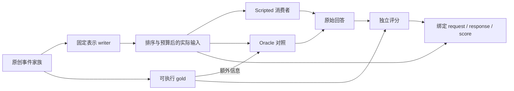

# Agent Memory Study

**经验如何成为可继承、也可改变的能力？**

AMS 从 agent memory 出发，研究信息、经验与智能的跨时间关系。我们关心经验怎样获得形式，过去怎样参与当下，以及系统怎样在改变中保持连续性。IR、表示、学习、数据系统及其基础问题，都可以在这里独立深入。

[进入研究书房](https://indeliblevivi.github.io/agent-memory-study/) · [工作 thesis](study/programme/thesis.md) · [怎样学习与生长](study/programme/method.md) · [研究体目录](study/README.md)

这里的 thesis 是可修订的研究立场。我们沿具体对象考察保留状态、取用条件和改变方式之间的关系，不预先假定所有 memory 都是同一种机制，也不要求每次学习交付一项工程建议。

## 从哪里开始

| 想进入的地方 | 可以读什么 |
| --- | --- |
| jieba、BM25、BGE-M3 究竟在做什么 | [找到一样的，还是找到相关的？](study/entries/retrieval-and-relevance.md)：从词项权重与混合排序的可行区间，走到原创集合中的近邻重合、精确率和召回率；网页可以改变候选数、排序和相关性定义。 |
| Database、Index、Retriever、Memory 怎样区分 | [一条记录、一种表示、一个记忆系统](study/entries/records-representations-systems.md)：从同一条工具版本记录看不同研究对象和功能角色。 |
| 同一份记忆，后来换个问题还够用吗 | [记忆需要为尚未出现的问题保留什么？](study/entries/future-questions-and-memory.md)：推导完整观察类的答案交集，并运行 32 个原创历史的有限检查。 |
| 新材料怎样改变已经形成的认识 | [索引也能学习——究竟学了什么？](study/entries/what-an-index-learns.md)：从指定章节追问监督与错误恢复；网页可插入记录，比较旧界、重新校准与重新拟合，并检查真实二分路径。 |
| 相同输出下怎样辨别不同机制 | [观察相同以后，还能怎样把机制分开？](study/entries/distinguishability-and-observation.md)：全类答案交集、允许行动与有成本和长度界的最短区分。 |
| 继续一项已有研究 | [经验怎样长成判断习惯](https://indeliblevivi.github.io/agent-memory-study/study/experience-becomes-policy/)：跨源论述、已保存的分类器学习与纠正结果，以及仍未回答的问题。 |
| 运行表示研究的离线控制 | [原事件／概括／并存执行器](research/representation-use-study/README.md)：原创事件、可执行真值、实际送达材料与绑定的运行证据；scripted/oracle 控制不等于模型效果。 |
| 检查更正怎样传到后续行动 | [修订传播与再写入实验](research/revision-propagation-study/README.md)：多层快照、延迟同步、单层干预与后续任务，区分持续错误和修好后的旧影响再现。 |
| 看项目长期关心什么 | [经验的形式](study/programme/directions/forms-of-experience.md)、[当下的相关性](study/programme/directions/relevance-in-context.md)、[改变与继承](study/programme/directions/change-and-continuity.md)。 |

这些新文章是基于公开来源与原创例子写成的研究内容，不是私人聊天的重建。当前有 15 篇学习／研究文章、27 份来源札记、2 个问题专题、5 条实践判断。领域与方向只是可改的阅读地图；数量、关联和阅读深度不代表个人掌握度。

## Relata × AMS 交叉研究

[交叉研究准备包](research/relata-ams-campaign/README.md)把未知未来用途、更正传播与原生操作的可观察边界接到现有实验。共享来源、family lineage 和实际交付证据；各自的 estimand、允许行动与研究结论保持独立。P1/P2 的独立出题流程和 operation map 是研究准备，不是新的自然语言模型结果。P3/P4/P6 保留各自设计，Relata 的人与互动研究独立进行；参数学习、cache 与跨模型 KV 研究也不以关系应用为前提。

当前下一代源码位于 `next/ams` 集成分支；它接续 PR #7/#8 的研究内容，尚未合入 main 或部署。具体状态见[当前状态](docs/current-state.md)。Relata 的固定 capture reader 后续另有具名执行包；既有 scripted/oracle 矩阵不冒充真实语义能力。

## 研究怎样生长

从名字、例子、公式或疑惑开始，把真正学到的解释写下来。需要深入时，可以做推导、辨析定义、寻找反例、对读原文、观察实现或设计实验；增加论文数量只是其中一种手段。新材料可能补基础、解释机制、构成反例、开启旁支，也可能暂时放下。它的去向取决于内容，不能由相似度自动决定。

[研究方法](study/programme/method.md)说明怎样选一次研究的落点、接住新材料、修订已有理解，以及在哪里停下与继续。[作者指南](docs/authoring.md)提供实际的文件、命令和发布流程。一个简短学习记录无需先有成熟问题、实验或统一的章节模板。

## 仓库里的研究体

| 真源 | 负责什么 |
| --- | --- |
| `study/programme/` | 工作 thesis、研究方法与长期方向的完整论述 |
| `study/entries/*.md` + `*.json` | 正文与轻量 metadata；programme 的 metadata 也在这里 |
| `study/source-corpus/` | Work 身份、发布或观察 Revision，以及分别署名的 AMS 来源札记 |
| `study/inquiries/` | 持续的问题、竞争解释与下一步 |
| `study/transfers/` | 可选的实践判断、适用条件与公开取用记录 |
| `study/map.json`、`catalog.json` | 研究导航、展示次序与旧 atlas 定义 |
| `research/` | 各项研究自己的协议、runner、输入、结果与限制 |

`tools/content.py` 从 Work/Revision/Note 真源编译兼容的 `data/materials.json`，`tools/build.py` 生成 `assets/materials-data.js`，并生成不含全文的 `data/public-corpus.manifest.json`、按需读取的 `data/corpus/` shards 与 `data/route-inventory.json`。这些生成物不能手工编辑。原有 ID、材料深链接、27 份札记、4 篇共读与研究 receipts 均继续可查；旧 material ID 是 Work + AMS note 的组合 alias，不改变论文作者与札记作者的身份。

## 人与机怎样继续读

每篇来源、文章、问题与实践判断都有同源的 Markdown / JSON 研究包，包含正文或札记、署名、范围、版本日期和显式 ID 引用 manifest。包不抓取引用全文、不递归展开整个研究库，也不把研究文字当作 agent instructions。

```bash
node tools/export_study.cjs --kind study --id retrieval-and-relevance --format markdown
node tools/export_study.cjs --kind question --id experience-to-capability --format json
```

网页详情可导出研究包。构建中的对象目录也有 `index.md` 与 `index.json`，不需要 JavaScript。JSON v2 带固定记录 revision 和直接引用 manifest；编辑日期仍只是阅读信息，不替代内容身份。研究包不递归打包依赖全文；私人 workspace 则包含恢复所需的固定依据。

四个空间分别承接继续工作、探索文章、整理资料和执行本地实验。全局“带进来”先保存遇见的原话、文件和当次缘由，不要求先有标题或研究计划。公开书房的私人状态只留在页面，刷新前要下载；明确启动 `ams serve` 后，案头、原件、版本与任务才保存到自己指定的本地目录。

案头连接多对象选材、对读、固定版本摘录／批注、自己的问题、解释、返回条件和演算位置。每个案头最多 24 个对象、每对象 12 条摘录，编辑 payload 限 2 MiB；v3 完整保存文件限 32 MiB / 512 个私有记录版本。所有接受的页面内状态都必须可下载。容量拒绝保留原工作和历史，仍能导航与导出；旧摘录保留独立依据，选择当前正文不会改写它。

新文件使用 `ams-workspace/3`，显式预览后兼读 continuation v1 和 workspace v1/v2。旧文件若没有可靠的版本信息，保留为待核对的观察，不能把当前正文冒充旧依据。案头共享最多 20 步 / 8 MiB 的页面内撤销历史；历史不写入下载文件。私人 Markdown 供阅读，完整恢复用 JSON。断线或冲突时可带走尚未收到保存回执的输入，再比较恢复。

本地环境还提供原件取得和文本／PDF 提取、记录实际阅读范围、原生研究任务与 evidence 工作台，以及带 base 的修订和选择性发表 preview。正式论证关系与普通引用分开，修改审阅、私有应用和公开交付分别记录。默认服务不写 Git、不激活站点，也不运行付费或真实 provider 研究。

“公开选材包”只导出选定的当前公开对象，案头名称、问题、私人笔记、摘录记录／用途／批注和旧快照不会混入。机器也能沿同源出口取用：

```bash
node tools/export_study.cjs --select study:retrieval-and-relevance \
  --select study:what-an-index-learns --format markdown
node tools/export_study.cjs --workspace /path/to/ams-workspace.json --format json
```

索引演算的分布、插入状态、维护方式与查找键可以随案头 JSON 恢复，也保留在公开演算 URL 中。这里只能选择固定教学数据与有限整数键；个人笔记继续留在文件内。无 JavaScript 页面保留默认图解、结果与逐键表，移除操作控件。

旧 v1/v2 案头也能经 `tools/author.py draft-from-workspace` 整理成 repo 外的 draft；新 v3 在本地“整理成文”继续写作，保留问题、推敲、摘录与来源限制；不会自动发表或把选材升级为支持关系。作者影响检查 `impact ID --kind study` 与网页共享显式引用图，并从当前 canonical 编译，列出直接／间接检查路径。命令与正式采用步骤见[作者指南](docs/authoring.md)。

[案头使用说明](docs/study-workspace.md)记录完整使用、恢复和公私导出边界；[研究系统与建设方向](docs/research-system.md)说明这些能力如何服务 thesis，以及仍需继续的内容、研究连接与可靠性交付。

已有实践 brief 仍可独立取用：

```bash
node tools/export_practice.cjs --query '候选增加之后，结果被重复条目占满' --format markdown
node tools/export_practice.cjs --finding revision-needs-scope --format json
```

实践查询是本地 lexical matching，最多三条；全站搜索是跨字段多词 AND。不同条件的独立 finding 保留独立名额，重复 evidence 不增加排名。[维护与取用边界](docs/research-practice.md)和[公开采用记录](docs/practice-brief-use.md)区分引用、采用与实际有效。

## 本地编辑与检查

开发与本地服务使用 Python 3.13+、Node.js 26+；本地 WAL 环境需要包含 WAL-reset 修复的 SQLite 及 FTS5；当前验证版本是 3.53.4（也接受 3.51.3+ 及已明确修复的维护分支）。公开静态产物无需 backend 或 npm runtime。

```bash
python3 -m venv .venv
. .venv/bin/activate
python3 -m pip install -r services/local/requirements.txt
npm --prefix apps/reader ci
python3 -B tools/build.py --write-json
python3 -B tools/verify_reader.py
python3 -B tools/seo_build.py --base / --output dist/preview
python3 -m http.server 8080 --directory dist/preview
```

打开 `http://localhost:8080/`。独立文件阅读使用构建出的 `dist/preview/portable/index.html`；源码 checkout 不再包含第二套 reader。持久研究环境另开终端明确启动：

```bash
python3 ams --data-root /path/to/private-ams serve --site-root dist/preview
```

数据目录须在 repo 外、位于同机文件系统。多案头、CLI、备份、升级和新目录恢复见[本地环境](docs/local-workspace.md)。Pages base 默认为 `/agent-memory-study/`，本地服务读取同一构建的 base，不需要维护第二份界面。

```bash
python3 -m pip install -r tools/browser-requirements.txt
python3 -m playwright install chromium
python3 -B tools/verify_reader.py --browser
```

这是 CI 与本地共用的验证入口。`--browser` 新建静态产物，再检查 public、portable、真实本地服务、重启恢复和 casebook。构建拒绝覆盖旧输出，重复执行指定新的 `--site-root` / `--evidence-root`；`dist/` 不进 Git。

默认验证覆盖 canonical / generated drift、版本和 graph 合同、持久仓储与恢复、source-aware 接续、研究包、搜索、演算、正式修订与发表边界，以及各研究原生合同、有限检查、FTS5 检索控制和 stdlib 分类器。AgeMem、C2C、Jev 只检查已保存 receipts，不运行 pretrained inference 或论文 benchmark。修订传播的 compact summary 不替代完整 raw replay；各项额外依赖与复跑仍以 `research/*/README.md` 为准。

表示执行器保存实际请求、送达材料、原始回答与评分身份，支持 dry-run、续跑和离线重放检查。
运行文件完整写入后才原子发布，已有文件不覆写；中断尝试保留证据，续跑另建 attempt。
已正式发布的文件若损坏则拒绝验收，不能把损坏悄悄当作未执行。
诊断预算的单位与 tokenizer 身份必须随结果保存；离线计数不能冒充实际模型 token。
完整自然语言效果比较仍待执行。人工校准使用[离线 casebook](research/multilingual-use-policy/README.md)：
`ams-memory-reviews/2` 将审阅绑定到材料内容和 rubric；旧 sidecar 或材料变更须显式
`rebind-reviews` 到新文件，保留旧审阅并重新确认，不能凭同一 case ID 沿用 confirmed。

[修订传播执行器](research/revision-propagation-study/README.md)进一步把 canonical、index、summary、context 和后续写回拆开观察。各分支从同一修订前检查点出发，按预先固定的任务与同步调度演进；第 1、3、10 个后续任务分别检查应改、应保留、范围外与合法历史查询。单层干预后产生的输出属于该分支自己的后续历史，不能再把它与其他分支匹配成相同输入。这里使用 typed synthetic events 与 scripted policies；规则能消费正确标签，不表示语言模型能从对话中识别这些标签。删除消融也不构成隐私删除保证。

离线执行把材料生成、消费者和评价分开；图中的普通消费者只读取最终送达材料：



## 发布、隐私与来源

发布面继续是 **GitHub Pages**。`apps/reader/src/` 是唯一 React/TypeScript 界面和正文 renderer；Node prerender 与浏览器共享组件，`tools/seo_build.py` 是构建入口。真实路径、旧 query URLs、场景、锚点、history、no-JS 正文和 portable file reader 保留。内容按需读取，首页 bootstrap 不内嵌全部正文。普通阅读不需要本地服务。[网站运维说明](docs/website.md)记录构建与发布边界。

页面使用雾白、蓝灰墨和暖铜色，文章先于图形。探索可切换浅色星图与三维研究体；手机星图先显示选中对象的局部引用，也能展开全图。两者共享 `research-map.js` 的真实身份与显式关系，位置不表示语义相似度。拖动、键盘、列表和正文入口并存；reduced-motion 默认静止，离屏停帧，缺少 WebGL 有静态替代。

Newsreader、Noto Serif SC、Instrument Sans 与 Noto Sans SC 的 OFL 子集由本站提供；图形用 SVG / WebGL 与数学代码绘制。字体来源和重建方法见[字体说明](assets/fonts/README.md)。

公开书房没有账号或访客档案，不探测 localhost。私人接续不上传、不写 URL、localStorage 或 analytics；仅明确启动的本地服务把这些内容保存到指定目录。公开搜索、分组筛选和演算状态会进入可分享 URL 与浏览器历史，加载时发给托管服务；不要在公开搜索输入私人内容。既有 Cloudflare Web Analytics aggregate beacon 是唯一 analytics，不使用 cookie 或 localStorage，无 custom events；本地服务和 file reader 不发送该 beacon。外部来源链接在主动打开时访问相应网站，取得外部材料另需明确的 acquisition plan。构建与浏览器验收拦截非本机请求。

来源札记明确区分原文主张、作者报告、AMS 观察与编辑推论，`noteDepth` 只表示来源阅读范围。未执行协议、教学例子、确定性实验、固定源码 receipts 与实际模型研究各自标明边界；不因文章变成熟或页面重做而提升结论。

27 份书目中，10 份 PDF 按已确认的再分发条件随站提供，17 份链接 official full text。RDF 与 PDF 的交付边界保持原样；[Zotero 导入指南](ZOTERO-IMPORT.md)、[第三方 notices](THIRD_PARTY_NOTICES.md)、[权利说明](NOTICE.md)分别负责对应范围。最近 tagged Zotero package 不保证包含 main 的最新内容。重建没有扩大任何许可；[2026-08 项目介绍 PDF](publications/README.md)保留为当时版本的记录。

贡献入口见 [CONTRIBUTING](CONTRIBUTING.md)，稳定工程约定见 [AGENTS](AGENTS.md)。
