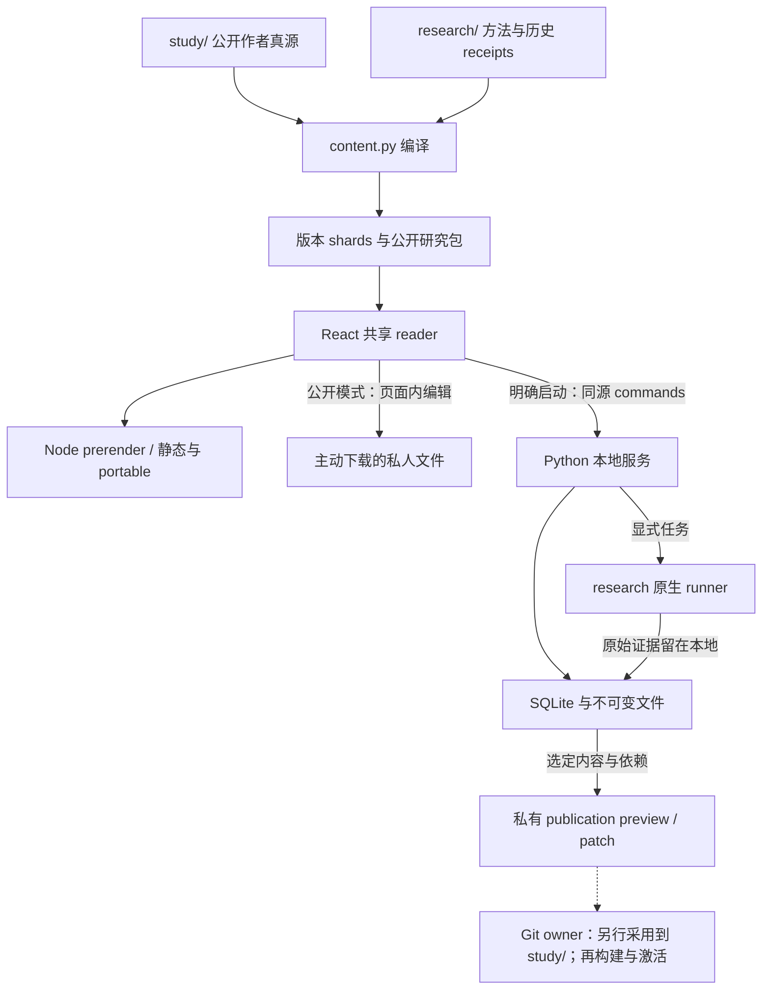

# AMS 的研究系统与建设方向

AMS 研究经验、信息与智能的跨时间关系。成熟形态是一间能够持续开展研究的书房：从一个词获得解释，把不同机制放在一起推敲，让新材料修订已有认识，使人和机器都能够带着依据回来。工作 thesis 与方法分别由 [thesis](../study/programme/thesis.md) 和 [method](../study/programme/method.md) 拥有；本文解释系统怎样服务它们。

## 已经贯通的能力与边界

| 工作 | 当前路径 | 仍需人的判断 |
| --- | --- | --- |
| 从概念进入研究 | 轻量 Markdown 文章、原创集合演算、领域与方向入口 | 解释是否充分、下一问是否值得问 |
| 跨来源推敲 | 来源范围、双向显式引用、研究案头中的选材／对读／带版本摘录 | 相同术语是否指同一对象、材料支持什么 |
| 保存与再进入 | 公开模式的可携文件、明确启动的 SQLite 本地环境、固定依据与章节／演算恢复、有限撤销／重做 | 原笔记和摘录在新正文下是否仍然成立 |
| 人机共同取用 | 同源单篇研究包、顺序选材包、CLI、静态 Markdown / JSON | 引用、解释、推论与执行指令的区别 |
| 复核实证主张 | 各项 `research/` 的方法、runner、原始证据与 replay 边界 | 证据回答的对象、外推条件与独立性 |
| 修订和发表 | 显式引用 impact、正式论证的范围检查、带 base 的 ChangeSet、逐 owner apply 与选择性发表 preview | 修改哪些论证、哪些私人文字可公开、署名与依据是否成立 |

这些能力使 AMS 成为可用的研究系统；它仍不自动发现研究问题、判断材料的支持强度或评价人的掌握度。真实 FTS5 检索、结构化分类器学习、固定源码审计、模型缓存观察与 scripted controls 是不同的研究资产。保存的 receipt、离线重放与新的模型执行必须分别说明，不能因为页面统一而合并为一个效果结论。

## 状态与作者真源

下图回答“谁拥有哪一份状态，私人工作怎样接回公开研究”；节点与箭头对应 compiler、React adapters、Repository、原生 job 与 publication 服务的实际边界。

`study/`、各项 `research/` 与私人仓储分别拥有公开解释、研究方法／证据和进行中的工作。公开索引在本地 DB 中只是固定版本 cache；私人理解不会自动回写 Git。默认 HTTP 服务只能产生有 base 的 preview / patch，应用、Git commit、站点激活是不同 receipt。

新案头使用 `ams-workspace/3`：固定 revision、独立摘录依据和恢复所需的字节随文件保存；兼读已存在的 continuation v1、workspace v1/v2。没有可信旧版本的材料保持待核对，不能用日期代替内容身份。当前正文的选择不改写原摘录。`assets/study-desk.js` 只保留已有文件解析和原创演算消费者，当前多案头状态由 `apps/reader/src/desk-store.ts` 拥有。完整边界见[案头说明](study-workspace.md)和[本地环境](local-workspace.md)。

`research-map.js` 维护唯一显式引用提取：星图把它投影为无向边，网页分开显示出处和引用者，作者 impact 沿反向引用给出最短检查路径。CLI 先编译当前 canonical，再调用这一实现；不会因为 generated projection 尚未重建而漏掉刚写入的正文链接。领域、方向和共享主题只作导航，不变成引用或依赖。

## 连续建设的主线

**解释与研究内容继续变深。** 三条方向仍然各有独立研究价值。下一次工作可以从推导、概念史、比较或反例进入，不能因为实验容易计数，就只追求更多矩阵、fixture 和 receipt。新工具应让解释承担更多工作，并留下具体内容上的变化。

**研究过程形成闭环。** [IR 入口](../study/entries/retrieval-and-relevance.md)已继续从机制定义推导词项权重、凸组合的可行条件与候选范围，并保留反例及邻近可行例；这是解释上的增长，不是新模型结果。[索引入口](../study/entries/what-an-index-learns.md)也已从摘要对照推进到指定章节阅读与原创推导：把位置预测、校准、局部证书和回退拆开，实际插入记录比较参数与保证各自如何变化；DSI 的相关性判断保持独立。当前案头已接通选材、对读、带来源版本的摘录与批注、可恢复编辑、保存／打开、内容变化检查与私人作者草稿。下一步应使用这条路径实际深化研究：让一份新材料改变一处可指认的解释，沿引用检查相关论证，再由作者选择和核对值得公开的内容。引用 impact 仍只是重读范围，不能自动推断论点失效；私人草稿也不自动发表。工具是否值得继续扩展，取决于这些真实研究过程中出现的阻力。

**实证连接沿自己的问题推进。** 候选检索、有限名额、实际送达与后续使用之间还有值得补齐的执行连接；真实自然语言消费者也不能从 scripted/oracle 控制中推断出来。这些研究从各自的 estimand、family lineage、预算和访问边界出发，按需接入已有能力。尚未出现第二个真实消费者时，不为了统一架构抽取跨研究框架；新的 provider、人类或私人材料研究需要各自的执行范围。

**可靠性交付服务真实使用。** 保留 portable file reader、旧 URL、无 JavaScript 正文、可携研究包和 GitHub Pages 发布面；新交互必须经历公共产物、真实本地服务与重启恢复验收。源码、commit、CI 与线上激活分别记录。系统的成熟度最终取决于研究能否持续开展、解释能否被重获和修订，而不是控件数量或通过的测试总数。
