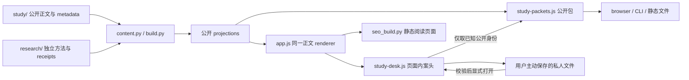

# AMS 的研究系统与建设方向

AMS 研究经验、信息与智能的跨时间关系。成熟形态是一间能够持续开展研究的书房：从一个词获得解释，把不同机制放在一起推敲，让新材料修订已有认识，使人和机器都能够带着依据回来。工作 thesis 与方法分别由 [thesis](../study/programme/thesis.md) 和 [method](../study/programme/method.md) 拥有；本文解释系统怎样服务它们。

## 已经贯通的能力与边界

| 工作 | 当前路径 | 仍需人的判断 |
| --- | --- | --- |
| 从概念进入研究 | 轻量 Markdown 文章、原创集合演算、领域与方向入口 | 解释是否充分、下一问是否值得问 |
| 跨来源推敲 | 来源范围、共读正文、显式引用、研究案头中的选材与对读 | 相同术语是否指同一对象、材料支持什么 |
| 保存与再进入 | 本地案头文件、单篇接续、章节与演算恢复、当前内容变化提示 | 原笔记在新正文下是否仍然成立 |
| 人机共同取用 | 同源单篇研究包、顺序选材包、CLI、静态 Markdown / JSON | 引用、解释、推论与执行指令的区别 |
| 复核实证主张 | 各项 `research/` 的方法、runner、原始证据与 replay 边界 | 证据回答的对象、外推条件与独立性 |
| 修订和发表 | 作者身份/影响 helper、canonical compiler、共享 renderer、浏览器与静态构建检查 | 修改哪些论证、署名与公开许可是否成立 |

这些能力使 AMS 成为可用的研究系统；它仍不自动发现研究问题、判断材料的支持强度或评价人的掌握度。真实 FTS5 检索、结构化分类器学习、固定源码审计、模型缓存观察与 scripted controls 是不同的研究资产。保存的 receipt、离线重放与新的模型执行必须分别说明，不能因为页面统一而合并为一个效果结论。

## 状态与作者真源

公开内容只有 `study/` 一份作者真源，研究结果继续由各自的 `research/` artifact 拥有。案头中的私人理解不自动回写前者，也不修改后者；公开选材包只从已选择身份重新投影当前公开内容。案头快照仅帮助发现保存后的内容变化，不认证作者、不证明笔记正确，也不把编辑日期变成不可变 revision。

同一条笔记在单篇接续与整组案头中共用页面内状态。`ams-continuation/1` 保留既有单篇文件的读写；`ams-workspace/1` 保存多对象工作。协议不同是为了保留已发给读者的文件合同，不是两套笔记实现。操作与文件限制见[案头使用说明](study-workspace.md)。

## 连续建设的主线

**解释与研究内容继续变深。** 三条方向仍然各有独立研究价值。下一次工作可以从推导、概念史、比较或反例进入，不能因为实验容易计数，就只追求更多矩阵、fixture 和 receipt。新工具应让解释承担更多工作，并留下具体内容上的变化。

**研究过程形成闭环。** [IR 入口](../study/entries/retrieval-and-relevance.md)已继续从机制定义推导词项权重、凸组合的可行条件与候选范围，并保留反例及邻近可行例；这是解释上的增长，不是新模型结果。当前案头接通选材、对读、私人问题与理解、导出、重新打开和变化提示。接下来的重点是实际用它完成研究，再依据使用暴露的阻力改进：新材料怎样影响一条论证、哪些依赖需要重读、私人推敲中哪些内容经过署名和依据核对后值得成为公开文章。不能把私人草稿自动发表，也不能用更多管理字段替代研究。

**实证连接沿自己的问题推进。** 候选检索、有限名额、实际送达与后续使用之间还有值得补齐的执行连接；真实自然语言消费者也不能从 scripted/oracle 控制中推断出来。这些研究从各自的 estimand、family lineage、预算和访问边界出发，按需接入已有能力。尚未出现第二个真实消费者时，不为了统一架构抽取跨研究框架；新的 provider、人类或私人材料研究需要各自的执行范围。

**可靠性交付服务真实使用。** 保留 source file mode、旧 URL、无 JavaScript 正文、可携研究包和 GitHub Pages 发布面；新交互必须经历源码浏览器与实际静态产物验收。源码、commit、CI 与线上激活分别记录。系统的成熟度最终取决于研究能否持续开展、解释能否被重获和修订，而不是控件数量或通过的测试总数。
