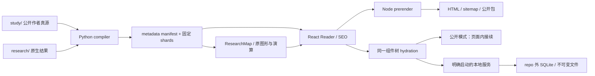

# 阅读站点：构建、验收与发布

公开地址为 <https://indeliblevivi.github.io/agent-memory-study/>，发布面继续使用 GitHub Pages。当前源码以 `apps/reader/` 的 React / TypeScript 组件树作为唯一正文与导航实现，`assets/seo.js` 拥有公开 route / metadata，Python compiler 产生公开内容。源码候选与线上激活状态见[当前状态](current-state.md)。

## 从研究体到页面



```bash
python3 -m pip install -r services/local/requirements.txt -r tools/browser-requirements.txt
npm ci --prefix apps/reader
python3 -m playwright install chromium
python3 -B tools/build.py --write-json
python3 -B tools/verify_reader.py --browser
```

`verify_reader.py` 是 provider-neutral 验证入口；不带 `--browser` 时检查合同、compiler drift、native 研究、仓储和前端状态。`--browser` 另外构建新的 `dist/site/` 并检查真实 public / static / local 与 casebook 交互。指定 `--site-root`、`--evidence-root` 可保留独立候选。所有浏览器检查使用专用 Chromium，阻止非本机请求。

生产构建只需 `python3 -B tools/seo_build.py`，其薄 wrapper 调用 Node `apps/reader/build.mjs`；Playwright 不再生成生产 HTML。Server render 与 client hydration 共用组件，公开 props 不含私人状态。JS、CSS、字体文件名带内容 identity，避免旧缓存与新页面错配。没有旧 `app.js`、独立手写首页或派生 `reader-shell.js`。

首页、material / study / question / finding 各有真实 HTML，数量由 canonical 枚举，另有 404。无 JS 可读完整正文、来源、保存的默认实验结果、真实引用链接与 JSON / Markdown 包；交互控件隐藏。首屏只含目录 metadata 与当前正文，全文和 receipt 按需打开。当前公开研究包为 `ams-study-packet/2`，固定实体 refs 与范围；v1 CLI 兼容边界见[案头指南](study-workspace.md)。

构建仅复制明确选定的公开研究、docs、字体／icons、canonical 正文与许可分发的 PDF、RDF、notices；不复制整个 checkout、`.git`、本地数据库、private drafts 或 raw run 目录。构建拒绝覆盖已有输出。`dist/` 不入 Git。

## 预览、离线与旧 URL

Pages artifact 的 base 为 `/agent-memory-study/`。可在预览根目录创建同名子目录／链接并启动 HTTP server；浏览器验收自动建立此挂载。普通根路径预览使用 `--base / --output dist/root-site` 后在该目录启动 HTTP server。本地研究服务可直接挂载任一受支持 base，见[本地环境](local-workspace.md)。

直接打开构建产物的 `portable/index.html` 可离线使用。它内嵌所有公开正文、固定记录、搜索与研究包，IIFE 使用 hash routes；不依赖文件协议下的 ESM 或 fetch。无 JS 时它仍是一份带真实内部锚点的完整研究读本。源码根目录不再提供第二套 HTML 入口。

保留四类物理 URL、旧 `?study=` / `?material=` / `?question=` / `?finding=`、domain / direction、thread / path、公开搜索和所属文章的演算参数。query navigation 不是 HTTP redirect。`#workbench` 进入继续，`#constellation` 进入探索星图；无 JS 详情应使用物理 URL。标题、canonical、Open Graph 与 JSON-LD 共用 SEO module，sitemap 不收录 query / scenario 或私人状态；站点验证标签与已批准的 aggregate beacon 保留。

## 图形、排版与私人状态

星图是“探索”的一个视图，手机默认显示当前对象与直接引用，完整图／列表／领域筛选仍可用。图面使用浅纸色、蓝灰与铜色；关系只来自显式 ID 和 compiler 识别的内部引用，位置不表示相似度。大目录显示有界局部图，目录本身可继续搜索。

三维研究体是另一个可选择的 programme 视图；沿用原生 WebGL / SVG owner、键盘选取、拖动、正文入口、reduced-motion、离屏停帧和 context-loss fallback。组件卸载释放 observers、事件与 animation frames，不改变别的空间的可见性。纯静态阅读保留完整文字目录，图形交互需要 JS。

中文正文使用 18px serif 与本地 OFL 子集，UI 有 Noto Sans SC 派生子集。无远程字体服务，来源与重建在[字体说明](../assets/fonts/README.md)。私人输入超出公开子集的字符可以使用设备 fallback。

公开模式私人状态只在页面和用户下载的文件，不写 localStorage，不探测 localhost；本地模式通过同源、受会话保护的 API 持久保存。两者在界面明确区分。公开词项查询和演算参数进入 URL / browser history，直接加载时托管方可见；私人文字不能输入公开查询。公开选材重新投影当前对象，不带私人摘录或旧快照。具体恢复边界见[案头指南](study-workspace.md)。

## 发布与回退

GitHub Actions 是唯一主要 CI owner。PR 只验证，不部署；main 验证通过后上传并由独立 deploy job 发布同一 artifact。CI 的 Ubuntu 24.04、Python 3.13、Node 26 与锁定的 Playwright 保持明确；独立构建 SQLite 3.53.4 到 runner 临时目录，核对官方源码 digest 和实际 Python binding，不替换系统库。

源码、commit、push、CI、Pages 激活是不同事实。公开 Git 写入和 Pages activation 不由本地 preview 或 passing tests 授权。发布后核对准确 commit、首页、详情、sitemap、404；回退用已验证的旧 artifact 或普通 revert 后重新构建，不改写共享历史。

本地数据库不能随旧网站 artifact 降级改写。升级前备份与新目录恢复流程单独由本地 runbook 负责。Pages account settings、DNS、Search Console 与 analytics 配置保留独立授权边界。项目在 github.io 子路径，robots 由 origin 根部负责；不虚构 lastmod 或已收录状态。
