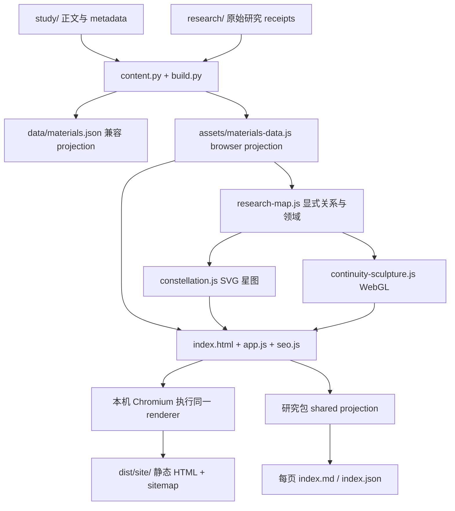

# 阅读站点：构建、验收与发布

公开地址为 <https://indeliblevivi.github.io/agent-memory-study/>，继续使用 GitHub Pages 和已有 Actions workflow。`study/` 是内容真源，`index.html` 是唯一源码 shell；`assets/app.js` 负责全部正文，专用组件负责图形与演算交互，`assets/seo.js` 统一 route / metadata。Python Playwright 与 Markdown parser 只用于构建和检查，发布产物没有 backend runtime。

## 从研究体到页面



在自己的 Python virtual environment 安装依赖：

```bash
python3 -m pip install -r tools/content-requirements.txt -r tools/browser-requirements.txt
python3 -m playwright install chromium
python3 -B tools/build.py --write-json
python3 -B tools/verify_reader.py
python3 -B tools/test_reader_browser.py --output-dir dist/browser-check
python3 -B tools/test_casebook_browser.py --output-dir dist/browser-check/casebook
python3 -B tools/seo_build.py
python3 -B tools/test_static_reader.py
```

构建只请求本机 HTTP，捕获 renderer 生成的正文与 metadata，然后删除非活动／hidden 内容，避免文章初始 HTML 混入首页和另一份来源栏。`reader-shell.js` 从原始 `index.html` 派生，用于开启 JS 时恢复完整交互 shell；它不是第二份手工维护的文章模板。改动 reader assets 或 generated data 时更新 `index.html` 的 cache version；派生 shell 使用 app 相同的 version，避免旧 shell 与新 renderer 混用。静态捕获里的 3D canvas 恢复为 SVG fallback，启用 JS 后才初始化 WebGL，保证无 JS 时也有完整封面。

首页和每份 material / study / question / finding 对应真实的 `index.html`。当前 27 份来源、12 篇文章、2 个问题、5 条判断共生成 47 个阅读页面，另有 `404.html`；总数按 canonical 枚举。详情目录还生成 `index.md` / `index.json`，通过页面研究包入口读取。构建期、CLI、browser 的包使用同一实现；不嵌入引用的论文全文或重复保存实验 receipt。

构建拒绝覆盖已存在的输出。重复构建用 `--output dist/site-next`，验收传 `--site-root dist/site-next`。`--browser-executable` 可指定专用 Chromium，不使用日常浏览器 profile。`dist/` 忽略，不提交。

复制范围包含 tracked `assets/`、公开 `research/` 和 `docs/`，明确的 reader 依赖、canonical 引用的正文、允许分发的 PDF、RDF、历史项目介绍 PDF、manifest 与 notices。不会复制整个 checkout、`.git`、`tools/`、private drafts、个人接续或机器状态。

## 预览与路由

源码可通过 `python3 -m http.server 8080` 或直接打开 `index.html` 阅读，使用 query routes。构建站点须挂载在 `/agent-memory-study/`：将产物放入预览根目录下的 `agent-memory-study/` 后从预览根目录启动 HTTP server。静态测试自动创建这一临时挂载。

公开路径有 `study/<id>/`、`material/<id>/`、`question/<id>/`、`finding/<id>/`。旧 `?study=` 等链接通过 browser location replace 转到相应物理页面，不是 HTTP 301。没有 JS 时直接使用物理路径；正文、普通阅读链接与静态研究包可读。源码 file mode 保留 query links。

首页 `?domain=` / `?direction=` 选择阅读分组，`?q=` 与 filters 用于搜索；旧 `?thread=` / `?path=` 自动展开 atlas 入口。已有场景 `scenario` / `phase` 保留。检索集合演算用 `k` / `ranking` / `need`，只作用于相应学习文章。Browser history 可恢复这些公开状态，sitemap 和 canonical 不收录查询／场景变体。

标题、description、canonical、Open Graph 与 JSON-LD 由同一 SEO module 生成。论文作者不被标成札记作者；展示、导出或索引不改变阅读深度与证据状态。

## 动态与私人接续

`research-map.js` 为两种图形提供相同的公开对象与显式关系。首屏 `continuity-sculpture.js` 把公开文章、来源、问题与实践判断投影成三维层片。叠置、展开、关联是同一批对象的三种布局；连线来自显式 ID 引用与已编译正文的内部链接，并合并重复关系，不推断语义相似度或支持强度。点击层片或文字选项可检查对象，打开对应正文；拖动及方向键旋转，Enter 选择下一片。视图与选取只在当前页面内存，不改变研究数据或写访客记录。

WebGL 无额外依赖；reduced-motion 默认静止，仍可手动操作和切换视图，也可主动旋转／暂停。离屏或标签页隐藏时停止 animation frame。WebGL 缺失或 context lost 时呈现 SVG，保留文字选取与正文入口，停用无作用的三维控制。静态捕获移除这些 JS 操作面和层片标签，保留可读封面；启用 JS 后恢复同一 shell。`tools/test_research_map.cjs` 与 `tools/test_research_sculpture.cjs` 验证身份、显式关联、领域与布局，browser tests 验证拖动、键盘、对象选取与阅读路由。

排版中的集合、索引映射和状态更新注记由 `study/map.json` 的可选 `notation` 提供，依据相连正文；它们不是新实验结果。学习入口的 SVG 分别解释集合交集、索引映射和参数更新，是原创示意而非实验数据；手机重排图形、控制与对象说明，正文阅读顺序保持完整。

`#constellation` 是主导航中的研究星图，不再藏于 legacy disclosure。`constellation.js` 使用 SVG、数学坐标与短程 camera easing；类型形状和颜色、领域标签、引用线、选取与相关节点可检查。类型／领域／标题和摘要关键词筛选、目录切换、聚焦引用、平移、缩放、复位及正文入口在手机和桌面相同；小屏重新计算纵向布局。支持 Fullscreen API 的浏览器提供“展开星图”，可通过同一按钮或 Escape 退出；打开正文时退出全屏。选中引用有线流动画，手动暂停、reduced-motion、离屏与页面隐藏均停止持续动画。地图不解释语义距离或证据强度，未分类对象保留独立星域。

星图搜索、相机、选取和筛选只存在当前页面内存，不写 URL、history、storage 或网络。星点与侧栏引用本身是实际正文链接；静态捕获移除 JS controls，关闭 JS 仍可打开正文。浏览器验收覆盖真实点击、键盘选取、平移／缩放、筛选空态与恢复、motion、深链接和 history。

排版使用本站提供的 OFL 字体子集，字体原始出处、许可、修改与离线重建流程见 [字体说明](../assets/fonts/README.md)。日常构建直接复制 checked-in WOFF2 与 notices，不获取外部字体，也不需要 fontTools。

接续笔记只存在页面内存及主动下载的文件，不上传或写入 URL / localStorage。导入最多 128 KB，恢复已知对象、受支持的 anchor 与演算，文本不执行。刷新前未下载的修改会丢失。公开研究包与个人接续是两个独立出口，不把个人文字带入共享包。

站点保留既有 Cloudflare aggregate beacon，不加 custom events 或其他 tracking。构建与测试拦截非本机请求；在线打开外部来源链接按用户操作发生。公开查询写入 URL 与 browser history，直接加载／刷新时 URL 会发给静态托管服务。完整使用边界见 [README](../README.md)。

## 发布与回退

现有 `.github/workflows/reader-validation.yml` 在 PR 和 main 运行同一组检查。PR 不部署；main 只有全部通过后，才上传并由独立 `deploy` job 发布同一 artifact。2026-10-18 的 Pages read-only 检查确认 `build_type: workflow`；本次无需切换账号设置。

源码完成、commit、push、CI 通过和 Pages 上线是不同状态。交付时核对目标 commit 的 `reader` / `deploy`，再读取公开首页、详情、sitemap 和一个不存在的路径。不要从本机构建成功推断线上已更新。

回退使用普通 revert commit，经过同一 workflow 重新发布，再核对线上页面和旧链接。不改写共享历史；Pages account settings、DNS、Search Console 与 analytics 配置不属于普通源码发布。

项目在 `github.io` 子路径，robots 规则由 origin 根部负责。保留公开 `google-site-verification` 标签；sitemap 列出物理阅读页，不虚构 lastmod。验证所有权、接受 sitemap、抓取、收录和排名分别核实。
