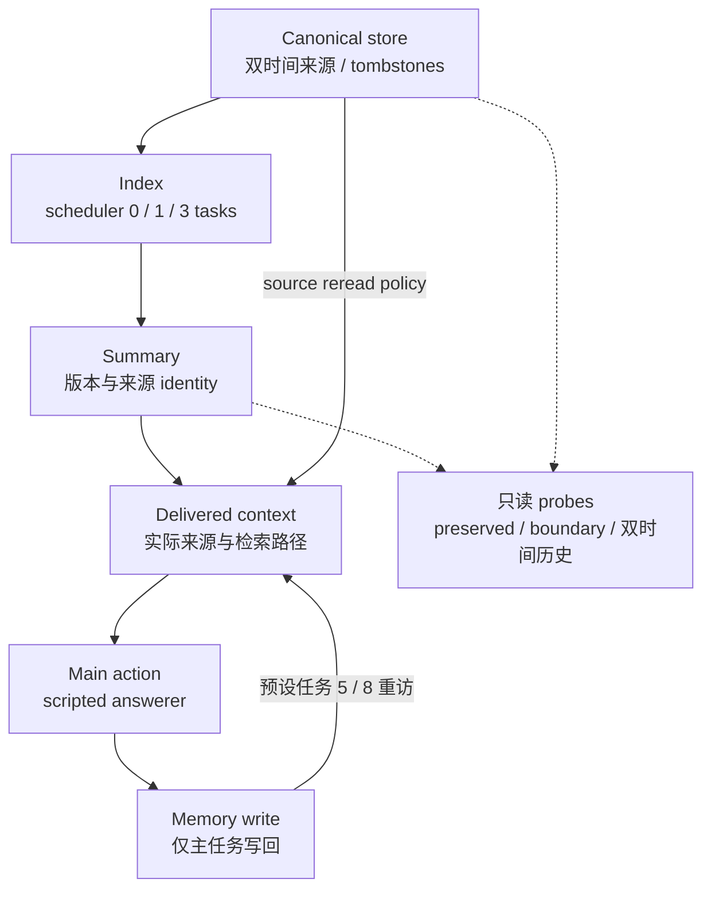

# 一次修订，十次后续任务

Agent Memory Study editors · 2026-10-23 · **WP4 / E2 原创 scripted/oracle controls**。

这个离线研究真实执行 canonical store、index、summary、delivered context、action 与下一轮
memory write 的状态演进，检查一次修订怎样延迟传播、在何处被挡住，以及旧 output 怎样回流。
它是固定结构化语义下的 development/diagnostic 实验，不是 LLM、真人或真实 memory 系统结果。
完整定义见 [protocol](protocol.md)。[旧单次更正规则演示](../correction-scope-study/README.md)
和 [表示消费端实验](../representation-use-study/README.md) 保持独立，旧 engine/receipts 不变。



`fixtures.py` 定义九个独立 event families：事实替换、scope 缩小、例外到期、承诺撤销、上游
前提纠正、authority conflict，以及无覆盖权新消息、另一项目消息、稳定未修订 controls。
事实替换有 retrospective correction：valid=0/observed=0 时知道 blue，valid=0/observed=2
按新证据应为 red；承诺撤销在 observed=2 被知悉、valid=3 才生效。合法历史不是一律保旧答案。

每 family 比较四 policies：append/latest、supersedes/versions、依赖失效重算、按需 source reread；
三 scheduler 延迟；tombstone/delete 两种 retention；十二 branches，共 **2,592 episodes**。
十二 branches 是 natural、四层 stale injection、各自 matched 单层 repair、三个 oracle 定位控制。
所有分支从共同修订前 checkpoint 深复制，外生 task schedule 相同；各臂输出/写回随后独自演化。
不同 policy、分支或重复任务都不增加九个 family 的独立样本量。

每 episode 十个主任务和每任务六个只读 probes，共七个 scoring rows；只读 probes 不写 memory。
完整矩阵是 **25,920 main actions、181,440 scoring rows**，另有一个 focused writeback on/off
配对对照，不增加 family。任务 5/8 重访自身第一条 write 是预设 synthetic pressure，不能称
自然发生率。关闭写回的配对分支用于区分旧 index 持续错误与修好后 old-output 回流。

`used=unknown`，不从引用推出 causal use。version-stale delivery 与条件于 stale 的错误分别
计数；旧影响 reappearance 还要求同 query/expected phase、先错→修好→再错，并绑定修订前
推荐和旧来源/支持，任意新错误另列。changed/preserved 从独立 gold 判定，boundary 属于 preserved
子集，历史题与这些集合也重叠。报告 1/3/10 task horizons、planned/executed/scored/family
分母和 task/recomputation counts；不把这些计数叫 wall latency 或 model tokens。

从 repo 根运行，只需 Python stdlib，无安装、网络或模型调用：

```bash
python3 -B research/revision-propagation-study/study.py dry-run \
  --report /tmp/ams-revision-plan.json
python3 -B research/revision-propagation-study/study.py run \
  --out /tmp/ams-revision-run --report /tmp/ams-revision-results.json
python3 -B research/revision-propagation-study/study.py replay \
  --out /tmp/ams-revision-run \
  --check-report research/revision-propagation-study/results.json
python3 -B -m unittest discover -s research/revision-propagation-study -p 'test_*.py'
python3 -B research/revision-propagation-study/study.py check-sample
```

所有输出路径必须为新的 repo 外路径。runner 不覆写已有目录；raw run 包含 manifest、完整分支
快照、actual delivery/action/write/score、单层 intervention 的紧邻 before/after，以及内容 digest
receipts。`verify`/`replay` 检查完整性和身份，重放确定性 transition，并重算冻结 action 的评分；
不声称重放模型 hidden state。whole-episode interrupted/partial 无 completion 时拒绝验收，保留
旧目录，在新 output 重跑。`--limit N` 可生成有 completion 的显式 partial-planned diagnostics，
分母保留未执行任务；不等于完整矩阵。不要对同一 output 并发运行。

`check-sample` 是快速 source identity / saved-summary accounting 检查，不执行矩阵，也不是
raw replay；原始矩阵的完整证据需上面的 replay。repo 只保存紧凑 [results.json](results.json)，
不保存 raw dirs。内容 digest 判断身份/完整性，不是签名，也不防能改写整个目录的攻击者。
删除旧 source 是 retention 消融，运行快照仍保留旧材料，不能称 privacy erasure。

源码边界：`fixtures.py` 拥有原创事件与独立 gold；`study.py` 是唯一 policy、scheduler、
branch evolution、receipt/replay 和聚合实现；`test_study.py` 负责能反驳错误策略与证据链的
regressions。本研究不抽取跨研究 framework，不新增 UI，也不改变其他研究的 truth owners。

已保存的 natural / delay=1 / tombstone 对照中，每 policy 有九个 families、90 main tasks、630
scoring rows（包括只读 probes）。十任务累计 correct 分别为 append-latest 280、versions 587、
dependencies 630、source-reread 630；预设压力下旧影响再现的 episodes 分别为 2、4、0、0。
这些是有意构造的反例，不构成总体排名或发生率。实现记录的主链 recomputations 分别为
9、9、18、99；source-reread 另记录只读 probe 重算，不把旁路成本混进主链。

focused fact-replacement/versions/delay1 中，开启 writeback 的 main correctness 为
`错、对、对、对、错、对、对、错、对、对`；关闭写回则第一轮错、后九轮对。任务 5/8 的
旧影响来自预设重访自身第一条 write 的压力机制。稳定未修订 family 中四 policy 都能维持
main 正确，说明复杂机制并非在所有情形必要。

versions/delay0 的合法历史 probes 共 360 rows，tombstone 为 350 correct，delete 为 260；
这里也包括 versions 不会重算 premise 的已知限制，不能将所有错误都归因于 retention。
历史损失与当前行动分开评分，删除消融并不等于任何隐私删除保证。
